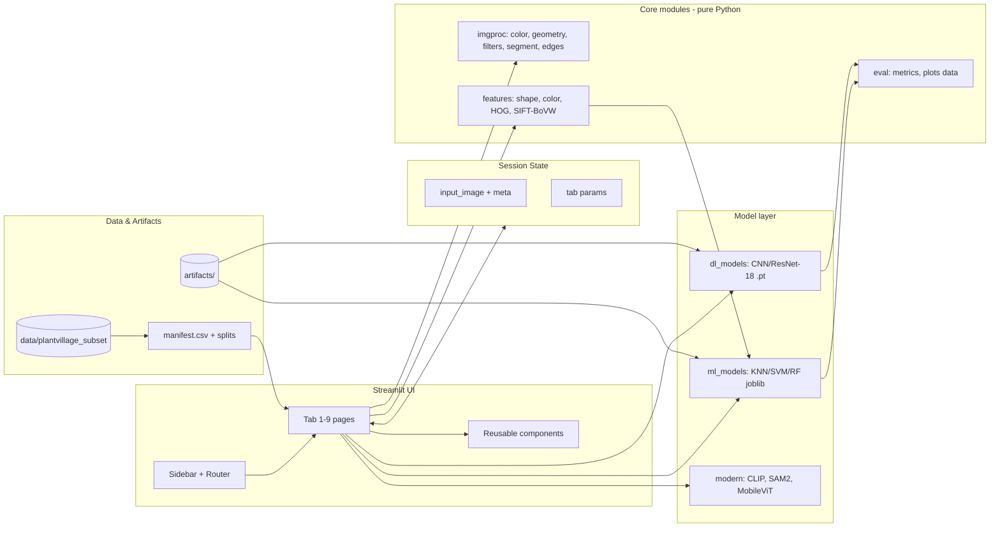
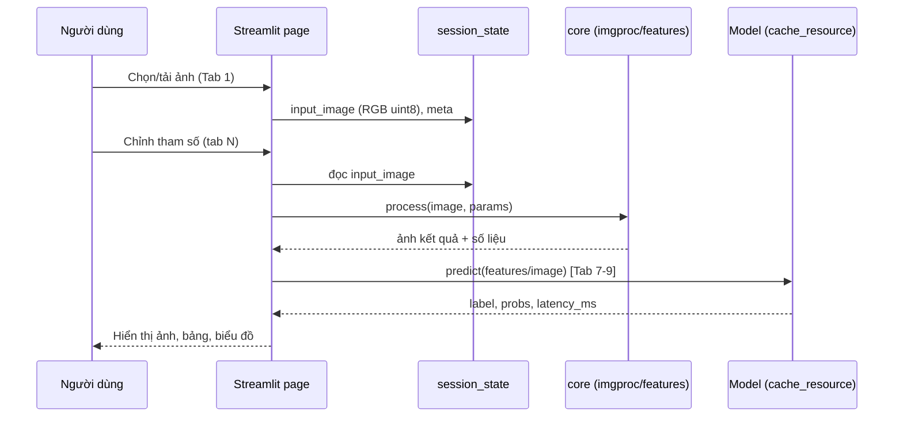

# Demo Implementation Specification (DIS)

**Demo:** Leaf Vision Lab — Tổng quan Thị giác máy tính & Xử lý ảnh số (Chương 1)
**Phiên bản tài liệu:** 1.0 · **Ngôn ngữ:** UI + DIS tiếng Việt, thuật ngữ kỹ thuật giữ tiếng Anh
**Trạng thái:** Bản đặc tả để bắt đầu triển khai (xem Mục 12 cho quyết định đã chốt và vấn đề tồn đọng)

---

## 1. Project Overview

### 1.1 Bối cảnh, mục tiêu, phạm vi, đối tượng

| Hạng mục | Nội dung |
|---|---|
| Bối cảnh | Học phần Computer Vision. Chủ đề nhóm đăng ký: **Chương 1 — Tổng quan về thị giác máy tính và xử lý ảnh số** (1.1 khái niệm & vai trò trong AI; 1.2 liên hệ xử lý ảnh – ML – DL; 1.3 các nhóm bài toán: 1.3.1 xử lý & biến đổi ảnh, 1.3.2 nhận dạng & phân loại, 1.3.3 mô hình hóa ảnh bằng nơ-ron) |
| Mục tiêu | Xây webapp tương tác giúp người học **thấy** được chuỗi: ảnh số → xử lý/biến đổi → trích đặc trưng → ML cổ điển → Deep Learning → các hướng hiện đại (2020+), trên **một bài toán xuyên suốt**: phân loại loài cây từ ảnh lá |
| Phạm vi (in) | 9 tab, dataset PlantVillage (tập con 6 loài, lá khỏe), chạy CPU, deploy free tùy chọn |
| Ngoài phạm vi (out) | Realtime camera/video, object detection, huấn luyện model lớn, bệnh lá (disease classification), mobile app, đăng nhập/lưu dữ liệu người dùng |
| Đối tượng | Sinh viên/giảng viên trong buổi báo cáo học phần; người học nhập môn CV |
| Nguyên tắc sư phạm | Mỗi tab trả lời 1 câu hỏi: "kỹ thuật này làm gì với ảnh, và vì sao nó dẫn đến bước tiếp theo?" |

### 1.2 Kiến thức CV được minh họa (mapping nội dung lý thuyết → tab)

| Mục lý thuyết | Nội dung minh họa | Tab |
|---|---|---|
| 1.1 Khái niệm CV & vai trò trong AI | Ảnh là ma trận số, nhãn, phân phối lớp, chất lượng dữ liệu; tab cuối cho thấy CV hiện đại | 1, 9 |
| 1.2 Xử lý ảnh – ML – DL | Cùng 1 bài toán, cùng test set: đặc trưng thủ công + ML (Tab 6–7) vs CNN học end-to-end (Tab 8) | 6, 7, 8 |
| 1.3.1 Xử lý & biến đổi ảnh | Không gian màu, histogram, biến đổi hình học, lọc nhiễu, phân đoạn, hình thái, cạnh | 2, 3, 4, 5, 6 |
| 1.3.2 Nhận dạng & phân loại | HOG/SIFT + SVM, KNN, Random Forest, metric, confusion matrix | 6, 7 |
| 1.3.3 Mô hình hóa ảnh bằng nơ-ron | Convolution, feature map, pooling, CNN/transfer learning, so sánh với ML cổ điển | 8 |
| Mở rộng (ngoài chương) | Zero-shot (CLIP), promptable segmentation (SAM 2), mô hình nhẹ (MobileViT) | 9 |

---

## 2. Functional Requirements

### 2.1 Cấu trúc trang

Sidebar trái (điều hướng 9 tab + nút "Đặt lại ảnh" + trạng thái ảnh đang dùng) và vùng nội dung bên phải (TITLE của tab + nội dung). Mọi tab dùng **chung một ảnh đầu vào** lưu ở `st.session_state["input_image"]`.

| # | Tab | Mức | Minh họa |
|---|---|---|---|
| 1 | Dataset Explorer | Bắt buộc | Ảnh số, nhãn, phân phối lớp, chất lượng dữ liệu |
| 2 | Image Processing Lab | Bắt buộc | Pixel, kênh màu, không gian màu, histogram |
| 3 | Geometric Transformations | Bắt buộc | Thay đổi tọa độ/hình học, augmentation |
| 4 | Noise & Filtering | Bắt buộc | Lọc không gian, đánh đổi khử nhiễu vs. giữ chi tiết |
| 5 | Segmentation & Morphology | Bắt buộc | Tách tiền cảnh/nền, mask nhị phân, hình thái |
| 6 | Edge Detection & Feature Extraction | Bắt buộc | Từ ảnh → số liệu định lượng (cầu nối sang ML) |
| 7 | Classical Machine Learning | Bắt buộc | KNN/SVM/RF, HOG/SIFT + SVM, metric |
| 8 | Deep Learning & Model Comparison | Bắt buộc | CNN, feature map, so sánh với ML cổ điển |
| 9 | Modern CV (2020+) | Tùy chọn (mở rộng) | CLIP, SAM 2, MobileViT-XXS, ResNet-18 baseline |

### 2.2 Chức năng chung (Global)

| ID | Chức năng | Acceptance criteria |
|---|---|---|
| G-1 | Ảnh đầu vào dùng chung | Chọn/tải ảnh ở Tab 1 → tất cả tab khác dùng cùng ảnh; đổi tab không làm mất ảnh |
| G-2 | Nút "Đặt lại ảnh" | Bấm → khôi phục ảnh gốc ban đầu, mọi tham số slider về mặc định |
| G-3 | Tải ảnh cá nhân | Chấp nhận JPG/PNG/WEBP ≤ 5 MB; ảnh lớn hơn 1024 px cạnh dài được tự thu nhỏ (giữ tỷ lệ) và có thông báo |
| G-4 | Cảnh báo ngoài miền dữ liệu | Với ảnh người dùng tải, các tab phân loại hiển thị cảnh báo: "Model chỉ huấn luyện trên lá nền đơn sắc của 6 loài" |
| G-5 | Mỗi tab có khối "Giải thích" | Tối đa 5 dòng: kỹ thuật là gì, tham số nào ảnh hưởng gì (tiếng Việt) |
| G-6 | Mọi kết quả hiển thị phải tính từ ảnh thật | Không dùng số/biểu đồ giả (xem Mục 9) |

### 2.3 User stories & acceptance criteria theo tab

**Tab 1 — Dataset Explorer**
- *US-1.1:* Là người học, tôi chọn ảnh mẫu từ thư viện dataset (lọc theo loài) để dùng cho các tab khác.
  - AC: thư viện hiển thị lưới thumbnail theo loài, chọn 1 ảnh → hiện ảnh gốc, kích thước (H×W), số kênh, dtype, nhãn loài.
- *US-1.2:* Tôi tải ảnh cá nhân để thử demo.
  - AC: theo G-3, G-4; ảnh tải lên được gắn nhãn "user_upload".
- *US-1.3:* Tôi xem thống kê dataset.
  - AC: biểu đồ phân phối số ảnh/lớp (Plotly), số ảnh train/val/test, kích thước ảnh (min/max/mean), kiểm tra ảnh lỗi/trùng (hash), 1 grid ví dụ mỗi lớp. Số liệu tính trực tiếp từ `manifest.csv`.
- *US-1.4:* Nút "Đặt lại ảnh" hoạt động theo G-2.

**Tab 2 — Image Processing Lab**
- *US-2.1:* Xem ảnh theo RGB, BGR (hiển thị sai kênh có chủ đích để giải thích), Grayscale, HSV.
  - AC: mỗi biểu diễn có mô tả shape/dtype; tách 3 kênh (R/G/B và H/S/V) hiển thị riêng.
- *US-2.2:* Chỉnh độ sáng (β) và tương phản (α) bằng slider.
  - AC: ảnh sau biến đổi cập nhật < 300 ms; hiển thị công thức `out = clip(α·in + β)`; so sánh ảnh gốc/sau cạnh nhau.
- *US-2.3:* Xem histogram.
  - AC: histogram từng kênh (RGB) và gray, trước/sau biến đổi, có tùy chọn Histogram Equalization và CLAHE (clipLimit, tileGridSize).
- *US-2.4:* Xem giá trị pixel.
  - AC: nhập tọa độ (x, y) → hiển thị giá trị BGR/RGB/HSV và vùng 5×5 dạng bảng số.

**Tab 3 — Geometric Transformations**
- *US-3.1:* Resize, crop, flip.
  - AC: resize theo tỷ lệ hoặc kích thước đích + chọn interpolation (nearest/bilinear/bicubic/area); crop bằng 4 slider (x, y, w, h) với khung hiển thị trên ảnh; flip ngang/dọc/cả hai.
- *US-3.2:* Rotation, scaling, translation.
  - AC: slider góc (−180…180°), tỷ lệ (0.25…3), dịch (tx, ty); hiển thị **ma trận affine 2×3** đang dùng.
- *US-3.3:* Affine & Perspective.
  - AC: kéo/nhập 3 điểm (affine) hoặc 4 điểm (perspective) nguồn → đích; hiển thị ma trận 2×3 / 3×3.
- *US-3.4:* Hiển thị hệ tọa độ trước/sau.
  - AC: overlay lưới tọa độ (gốc trên-trái, trục x phải, y xuống) và vẽ 4 góc ảnh gốc → vị trí sau biến đổi.
- *US-3.5:* Augmentation.
  - AC: tổ hợp (xoay ±, flip, brightness, noise nhẹ) với seed cố định; sinh lưới N=8 ảnh augment từ 1 ảnh; có nút "Seed mới".

**Tab 4 — Noise & Filtering**
- *US-4.1:* Thêm nhiễu nhân tạo.
  - AC: Gaussian (σ 0–50) và Salt-and-Pepper (tỷ lệ 0–20%); seed cố định; ảnh sạch luôn được giữ làm ground truth.
- *US-4.2:* Thử bộ lọc.
  - AC: Mean, Gaussian Blur, Median, Bilateral; kernel size lẻ 3–15 (Bilateral thêm sigmaColor/sigmaSpace); hiển thị ảnh nhiễu / ảnh lọc / ảnh sạch.
- *US-4.3:* So sánh định lượng.
  - AC: bảng MSE và PSNR (dB) giữa ảnh lọc và ảnh sạch cho tất cả bộ lọc ở cùng tham số; đánh dấu bộ lọc tốt nhất; cảnh báo ví dụ "Median tốt cho Salt-and-Pepper, Gaussian Blur làm mờ cạnh". Có crop zoom vào vùng gân lá để thấy chi tiết bị mất.

**Tab 5 — Segmentation & Morphology**
- *US-5.1:* Phân ngưỡng.
  - AC: Global threshold (slider), Otsu (hiển thị ngưỡng tự tính), Adaptive (Mean/Gaussian, block size, C); chọn kênh đầu vào (Gray/S/V/…); tùy chọn đảo mask.
- *US-5.2:* Phép toán hình thái.
  - AC: Erosion, Dilation, Opening, Closing; kernel hình (ellipse/rect) và kích thước, số lần lặp; hiển thị mask trước/sau.
- *US-5.3:* Hiển thị kết quả tách lá.
  - AC: 4 khung: ảnh nhị phân, mask cuối, mask phủ lên ảnh gốc (alpha), lá tách nền (nền đen/trong suốt); giữ contour lớn nhất.
- *US-5.4:* Đánh giá với ground truth.
  - AC: nếu ảnh thuộc dataset và có ảnh `segmented` tương ứng → tính IoU/Dice giữa mask của người dùng và mask tham chiếu; nếu không có → ẩn mục này (không hiển thị số giả).

**Tab 6 — Edge Detection & Feature Extraction**
- *US-6.1:* Phát hiện cạnh.
  - AC: Sobel (x, y, magnitude), Laplacian, Canny (2 ngưỡng); hiển thị cạnh cạnh nhau.
- *US-6.2:* Contour & hình học.
  - AC: tìm contour lớn nhất từ mask Tab 5 (hoặc Otsu mặc định); vẽ contour, convex hull, bounding box (x, y, w, h), minAreaRect.
- *US-6.3:* Đặc trưng định lượng.
  - AC: bảng: area, perimeter, aspect ratio, extent, solidity, circularity (`4πA/P²`), Hu Moments (7, log-scale); đặc trưng màu (HSV histogram, mean/std kênh); minh họa HOG (ảnh HOG + vector length).
- *US-6.4:* Xuất vector đặc trưng.
  - AC: hiển thị vector đặc trưng cuối cùng (độ dài, tên nhóm) và nút tải CSV → đây là đầu vào cho Tab 7.

**Tab 7 — Classical Machine Learning**
- *US-7.1:* Chọn đặc trưng & thuật toán.
  - AC: đặc trưng: (a) shape+color thủ công (Tab 6), (b) HOG, (c) SIFT Bag-of-Visual-Words; thuật toán: KNN, SVM (linear/RBF), Random Forest; chọn siêu tham số chính bằng widget.
- *US-7.2:* Huấn luyện/nạp model.
  - AC: nạp model đã huấn luyện sẵn (`artifacts/ml/*.joblib`) trong < 3 s; có nút "Huấn luyện lại" (CPU, có progress, giới hạn thời gian) trên tập train thật.
- *US-7.3:* Đánh giá.
  - AC: Accuracy, Precision, Recall, F1 (macro + từng lớp), confusion matrix (Plotly heatmap) trên **test set cố định**; hiển thị kích thước train/val/test.
- *US-7.4:* Dự đoán ảnh đang chọn.
  - AC: hiển thị nhãn dự đoán, xác suất/score (SVM `probability=True`/RF/KNN), top-3; ảnh thuộc test set thì hiển thị nhãn thật.
- *US-7.5:* Bảng so sánh các tổ hợp (đặc trưng × thuật toán): accuracy + thời gian inference/ảnh.

**Tab 8 — Deep Learning & Model Comparison**
- *US-8.1:* Minh họa convolution.
  - AC: chọn kernel (Sobel-x, Sobel-y, blur, sharpen, kernel tự nhập 3×3) → áp lên ảnh xám, hiển thị feature map, kèm bước pooling (max/avg) và kích thước trước/sau.
- *US-8.2:* Feature maps của CNN thật.
  - AC: hiển thị activation của các lớp conv đầu/giữa/cuối của model đã huấn luyện cho ảnh đang chọn (lưới tối đa 16 kênh/lớp).
- *US-8.3:* Phân loại bằng CNN.
  - AC: nhãn dự đoán, xác suất top-3, thời gian inference (ms) đo thật.
- *US-8.4:* So sánh với ML cổ điển.
  - AC: bảng/biểu đồ cùng **test set** với Tab 7: Accuracy, Macro-F1, thời gian inference/ảnh, kích thước model; hiển thị curves train/val loss-accuracy (từ log huấn luyện thật).
- *US-8.5:* Phân tích lỗi.
  - AC: lưới các ảnh test bị dự đoán sai (nhãn thật, nhãn dự đoán, confidence); lọc theo model.

**Tab 9 — Modern CV (2020+)** *(tên tab chốt: "Modern CV (2020+)")*
- *US-9.1:* CLIP ViT-B/32 zero-shot.
  - AC: nhập/sửa prompt template (mặc định `"a photo of a {species} leaf"`), hiển thị xác suất softmax trên 6 loài; ghi chú: không huấn luyện trên dataset này.
- *US-9.2:* SAM 2.1 Tiny (tùy chọn Small).
  - AC: người dùng chọn điểm click hoặc box trên lá → mask; so sánh với mask Tab 5 bằng IoU; hiển thị thời gian chạy.
- *US-9.3:* MobileViT-XXS (ImageNet-1k).
  - AC: top-5 nhãn ImageNet kèm cảnh báo: "đây là phân loại 1000 lớp tổng quát, không phải 6 loài của demo".
- *US-9.4:* ResNet-18 ImageNet baseline.
  - AC: top-5 nhãn ImageNet, dùng làm mốc so sánh kích thước/tốc độ/độ phủ với 3 model trên.
- *US-9.5:* Bảng "so sánh bản chất", **không có điểm số gộp**: model, năm, tác vụ, cần huấn luyện?, tham số, RAM, thời gian CPU/ảnh (đo thật).
  - AC: không xếp hạng các model khác tác vụ bằng một metric chung.

---

## 3. UI/UX & Visual Guidelines

### 3.1 Phong cách
- Phong cách học thuật – sạch, nhiều khoảng trắng, ưu tiên so sánh **trước/sau** cạnh nhau.
- Theme mặc định: sáng. Chủ đạo xanh lá (liên quan lá cây) + trung tính.

| Token | Giá trị |
|---|---|
| primary | `#2E7D32` |
| primaryLight | `#E8F5E9` |
| accent | `#F9A825` (điểm nhấn/cảnh báo nhẹ) |
| error | `#C62828` |
| text | `#1B1B1B` / secondary `#5F6368` |
| background | `#FFFFFF` / surface `#F6F8F6` |

- Cấu hình qua `.streamlit/config.toml` (`[theme]`).
- **Typography:** Inter (sans-serif) cho UI; JetBrains Mono cho code/ma trận; tiêu đề tab 28 px, mục 20 px, nội dung 16 px. Font phải hỗ trợ tiếng Việt có dấu.
- **Bố cục:** `layout="wide"`; sidebar cố định; tối đa 2–3 cột ảnh/hàng; tham số ở cột trái, kết quả ở cột phải.
- **Responsive:** thiết kế chính cho desktop ≥ 1280 px, vẫn dùng được ở 768 px (cột xếp dọc); không tối ưu điện thoại (nằm ngoài phạm vi).
- **Accessibility:** không chỉ dùng màu để truyền thông tin; ảnh có caption; tương phản chữ ≥ WCAG AA.

### 3.2 Wireframe

```
┌──────────────┬────────────────────────────────────────────────────┐
│ SIDEBAR      │  TITLE (tên tab)                                   │
│ Leaf Vision  │  ┌ Giải thích ngắn (≤ 5 dòng) ────────────────────┐ │
│ Lab          │  └────────────────────────────────────────────────┘ │
│              │  ┌ Tham số ───────┐ ┌ Ảnh gốc ─┐ ┌ Kết quả ──────┐ │
│ [Tab 1]      │  │ slider/select  │ │          │ │               │ │
│ [Tab 2]      │  │ ...            │ │          │ │               │ │
│ [Tab 3]      │  └────────────────┘ └──────────┘ └───────────────┘ │
│ ...          │  ┌ Số liệu / biểu đồ / bảng ─────────────────────┐ │
│ [Tab 9]      │  └────────────────────────────────────────────────┘ │
│ ──────────── │                                                    │
│ Ảnh hiện tại │                                                    │
│ [Đặt lại ảnh]│                                                    │
└──────────────┴────────────────────────────────────────────────────┘
```

### 3.3 Component tái sử dụng (`app/components/`)

| Component | Chức năng |
|---|---|
| `image_compare(before, after, captions)` | Hai ảnh cạnh nhau (tùy chọn slider so sánh) |
| `image_grid(images, captions, cols)` | Lưới ảnh |
| `param_panel(spec)` | Sinh widget từ cấu hình tham số + nút reset |
| `histogram_plot(img)` | Histogram Plotly |
| `metrics_table(df)` / `confusion_matrix_plot(cm, labels)` | Bảng metric/heatmap |
| `explain_box(text)` | Khối giải thích G-5 |
| `status_banner(kind, msg)` | Thông báo loading/error/empty/warning thống nhất |
| `matrix_view(M)` | Hiển thị ma trận biến đổi/kernel |

### 3.4 Trạng thái giao diện

| Trạng thái | Quy định |
|---|---|
| Loading | `st.spinner` kèm mô tả ("Đang nạp model CLIP…"); model nặng có progress; không chặn sidebar |
| Empty | Chưa có ảnh: hiển thị "Hãy chọn ảnh ở Tab 1" + nút chuyển tab; không hiển thị biểu đồ rỗng |
| Error | Thông báo thân thiện bằng tiếng Việt + gợi ý hành động (ví dụ: "Ảnh không đọc được, thử JPG/PNG"); chi tiết kỹ thuật ghi vào log, không in stack trace lên UI |
| Warning | Ảnh ngoài miền dữ liệu, kernel không hợp lệ, thiếu artifact (kèm lệnh tạo) |
| Disabled | Chức năng cần file không có (ví dụ ground truth Tab 5) → ẩn hoặc vô hiệu hóa kèm lý do |

---

## 4. Technical Stack & Dependencies

### 4.1 Công nghệ

| Lớp | Lựa chọn | Mục đích | Lý do |
|---|---|---|---|
| Ngôn ngữ | **Python 3.11** | Toàn bộ dự án | Ổn định, wheel sẵn có cho PyTorch/OpenCV/scikit-learn; vẫn tương thích yêu cầu ≥ 3.10 |
| Web | **Streamlit** | UI + backend trong 1 tiến trình | Nhanh, thuần Python, phù hợp demo học phần |
| Xử lý ảnh | OpenCV (`opencv-python-headless`), Pillow, NumPy | Đọc/ghi, biến đổi, lọc, contour, SIFT | Chuẩn công nghiệp; bản headless tránh phụ thuộc GUI khi deploy |
| Thuật toán ảnh bổ sung | scikit-image | HOG, đo lường (PSNR/SSIM), regionprops | API HOG/metric dễ dùng |
| ML cổ điển | scikit-learn | KNN/SVM/RF, KMeans (BoVW), metric, joblib | Chuẩn, nhẹ |
| Deep Learning | PyTorch + torchvision (**bản CPU**) | CNN/transfer learning, feature map | Hệ sinh thái model pretrained; hook dễ lấy feature map |
| Model hiện đại | `transformers` (CLIP, MobileViT) và `sam2` hoặc `transformers` (SAM 2.1) | Tab 9 | Nạp trọng số công khai trực tiếp |
| Biểu đồ/bảng | Plotly, Pandas | Histogram, confusion matrix, thống kê | Tương tác tốt trong Streamlit |
| Kiểm thử | pytest | Unit/integration test | Chuẩn |
| Chất lượng code | ruff (lint/format) | Nhất quán code | Nhẹ, nhanh |

- **Phiên bản:** pin bằng `requirements.txt` có khoảng phiên bản (ví dụ `streamlit>=1.40`, `opencv-python-headless>=4.10`, `scikit-learn>=1.5`, `torch>=2.5`) rồi **đóng băng chính xác** bằng `pip freeze` sau lần cài đầu tiên chạy ổn. Phiên bản chính xác ghi lại ở Mục 12 (Project State).
- **Tài liệu tham khảo:** [OpenCV Image Processing](https://docs.opencv.org/4.10.0/d2/d96/tutorial_py_table_of_contents_imgproc.html), [scikit-learn](https://scikit-learn.org/stable/).

### 4.2 Thư viện bị cấm / cần tránh

| Thư viện/cách làm | Lý do |
|---|---|
| TensorFlow/Keras | Tránh 2 framework DL song song, tăng dung lượng/RAM |
| `opencv-python` (bản GUI) khi deploy | Lỗi thiếu `libGL` trên server; dùng bản `-headless`. Không gọi `cv2.imshow`/`waitKey` |
| Model đã fine-tune sẵn trên PlantVillage từ Hugging Face/Kaggle | Mất ý nghĩa học thuật, không kiểm soát được leak dữ liệu |
| AutoML (auto-sklearn, AutoKeras, …) | Che giấu cơ chế, đi ngược mục tiêu giáo dục |
| Phiên bản PlantVillage "augmented" của Kaggle | Có rò rỉ dữ liệu giữa train/valid (xem Mục 6) |
| `pickle` nạp file không tin cậy | Rủi ro bảo mật; chỉ nạp artifact do dự án tạo ra |
| Gọi API bên ngoài/đám mây trong runtime | Demo phải chạy offline sau khi tải model |

---

## 5. System Architecture

### 5.1 Sơ đồ tổng thể



### 5.2 Cấu trúc thư mục

```
leaf-vision-lab/
├── app/
│   ├── main.py                    # entrypoint, router, sidebar
│   ├── pages/                     # tab1_dataset.py ... tab9_modern.py
│   ├── components/                # image_compare.py, param_panel.py, ...
│   └── state.py                   # session_state keys + helpers
├── core/
│   ├── imgproc/                   # color.py, geometry.py, filters.py, segment.py, edges.py
│   ├── features/                  # shape.py, color_hist.py, hog.py, sift_bovw.py
│   ├── models/                    # ml.py, cnn.py, modern.py (lazy load)
│   ├── data/                      # manifest.py, loader.py, splits.py
│   └── evaluation/                # metrics.py, timing.py
├── scripts/
│   ├── prepare_dataset.py         # chọn 6 loài, lấy mẫu, tạo manifest + splits
│   ├── train_ml.py                # sinh artifacts/ml
│   ├── train_cnn.py               # sinh artifacts/dl + log huấn luyện
│   └── download_models.py         # tải CLIP/SAM2/MobileViT/ResNet-18
├── data/
│   ├── raw/                       # PlantVillage gốc (không commit)
│   ├── plantvillage_subset/       # 6 loài × ~350 ảnh (không commit toàn bộ)
│   ├── sample/                    # ~20 ảnh/loài để deploy (commit)
│   └── manifest.csv
├── artifacts/                     # joblib, .pt, logs, metrics.json
├── tests/                         # unit + integration
├── docs/                          # DIS.md, DECISIONS.md, PROGRESS.md
├── .streamlit/config.toml
├── requirements.txt / requirements-dev.txt
├── Dockerfile                     # cho Hugging Face Spaces
└── README.md
```

### 5.3 Phân chia module

- **`core/` không import Streamlit** → test được độc lập, tái sử dụng được.
- **`app/pages/` chỉ gọi `core/` và `components/`**, không chứa thuật toán.
- **Model nặng nạp lazy** qua `st.cache_resource`, chỉ nạp khi vào tab cần.

### 5.4 Luồng dữ liệu



---

## 6. AI Model & Data Contract

### 6.1 Dataset

| Mục | Quy định |
|---|---|
| Nguồn | **PlantVillage** (CC0), bản **gốc không augmented** (thư mục `color`, tham chiếu `segmented`). Không thu thập lại dữ liệu |
| Lý do chọn | Lá đơn tách rời, nền đồng nhất, ánh sáng đều, chụp có kiểm soát → phù hợp mọi kỹ thuật ở Tab 2–8; có ảnh `segmented` làm tham chiếu cho Tab 5 |
| Bài toán | Phân loại **loài cây** từ ảnh **lá khỏe (healthy)** — 6 lớp |
| Lớp đề xuất | Apple, Blueberry, Cherry, Grape, Pepper (bell), Tomato — mỗi lớp lấy mẫu **350 ảnh** (seed 42) |
| Ràng buộc | Mỗi lớp ≥ 300 ảnh. `prepare_dataset.py` phải **kiểm tra và dừng với lỗi rõ ràng** nếu lớp nào < 300 (xem vấn đề tồn đọng OI-1) |
| Chia tập | Stratified train/val/test ≈ 70/15/15 (245/52/53 ảnh/lớp), seed 42, **lưu cố định vào `manifest.csv`** và dùng chung cho Tab 7, 8 |
| Rò rỉ dữ liệu | Nhiều ảnh có thể là cùng một chiếc lá. Chia theo **nhóm** (`group_id`) để không tách cùng một lá ra hai phía; cách suy ra `group_id` xem OI-2 |
| Kích thước ảnh gốc | 256×256 RGB (kỳ vọng; script kiểm tra và ghi vào Tab 1) |

**Schema `manifest.csv`:**

| Cột | Kiểu | Mô tả |
|---|---|---|
| `image_id` | str | Định danh duy nhất |
| `path` | str | Đường dẫn tương đối tới ảnh color |
| `seg_path` | str/null | Đường dẫn ảnh segmented tham chiếu (nếu có) |
| `label` | str | Tên loài (ví dụ `Tomato`) |
| `label_id` | int | 0–5, thứ tự cố định theo `labels.json` |
| `split` | enum | `train` / `val` / `test` |
| `group_id` | str | Nhóm chống rò rỉ |
| `width`,`height` | int | Kích thước |
| `sha1` | str | Hash phát hiện trùng |

### 6.2 Tiền xử lý

| Pipeline | Bước |
|---|---|
| Hiển thị (Tab 1–6) | Đọc RGB uint8 → giữ nguyên kích thước (ảnh người dùng: thu nhỏ ≤ 1024 px) |
| Đặc trưng thủ công | Resize 256×256 → mask Otsu (kênh S hoặc gray) + opening/closing → contour lớn nhất → shape features (area, perimeter, aspect, extent, solidity, circularity, 7 Hu moments log) + HSV hist (H16/S8/V8, chuẩn hóa) + mean/std kênh |
| HOG | Gray, resize 128×128, `orientations=9`, `pixels_per_cell=(16,16)`, `cells_per_block=(2,2)`, L2-Hys |
| SIFT-BoVW | Gray 256×256 → SIFT descriptors → KMeans `k=100` (huấn luyện trên **train**) → histogram chuẩn hóa |
| CNN | Resize 224×224, chuẩn hóa ImageNet (mean `[0.485,0.456,0.406]`, std `[0.229,0.224,0.225]`); augmentation chỉ ở train (flip, rotate ±20°, ColorJitter nhẹ) |
| Scaling cho ML | `StandardScaler` fit trên train, lưu trong pipeline |

### 6.3 Model

| Model | Vai trò | Trọng số | Huấn luyện |
|---|---|---|---|
| KNN / SVM (linear, RBF) / Random Forest | Tab 7 | `artifacts/ml/{feature}_{algo}.joblib` | Có, CPU, vài phút |
| **MobileNetV3-Small** hoặc **ResNet-18** (ImageNet pretrained) | Tab 8 – transfer learning: đóng băng backbone, huấn luyện head + (tùy chọn) block cuối, ~10 epoch | `artifacts/dl/cnn_best.pt` (< 50 MB) + `train_log.json` | Có, CPU |
| CNN nhỏ tự dựng (3 khối conv) | Tab 8 – minh họa convolution/feature map | `artifacts/dl/tinycnn.pt` | Có, CPU |
| CLIP ViT-B/32 | Tab 9 zero-shot | Hugging Face `openai/clip-vit-base-patch32` | **Không** |
| SAM 2.1 Tiny (Small tùy chọn) | Tab 9 segmentation | Checkpoint công khai của Meta | **Không** |
| MobileViT-XXS | Tab 9 | Checkpoint ImageNet-1k công khai | **Không** |
| ResNet-18 ImageNet | Tab 9 baseline | torchvision weights | **Không** |

Chọn mặc định cho Tab 8: **ResNet-18** nếu CPU chịu được; chuyển **MobileNetV3-Small** nếu inference/huấn luyện quá chậm. Quyết định cuối ghi ở Mục 12.

### 6.4 Input/Output schema

**Prediction (mọi model phân loại):**

```json
{
  "model_id": "resnet18_ft_v1",
  "label": "Tomato",
  "label_id": 5,
  "probs": {"Apple": 0.01, "Blueberry": 0.00, "Cherry": 0.02, "Grape": 0.01, "Pepper": 0.03, "Tomato": 0.93},
  "top_k": [["Tomato", 0.93], ["Pepper", 0.03], ["Cherry", 0.02]],
  "uncertain": false,
  "latency_ms": 42.7
}
```

**Metrics (`artifacts/metrics.json`, sinh từ test set thật):**

```json
{
  "model_id": "svm_rbf_hog",
  "split": "test", "n": 318,
  "accuracy": 0.0, "precision_macro": 0.0, "recall_macro": 0.0, "f1_macro": 0.0,
  "per_class": {"Apple": {"precision": 0.0, "recall": 0.0, "f1": 0.0, "support": 53}},
  "confusion_matrix": [[0]],
  "infer_ms_per_image": 0.0, "model_size_mb": 0.0
}
```
(Các giá trị `0.0` ở trên chỉ là placeholder cấu trúc; giá trị thật do script đánh giá ghi ra.)

**Quy ước chung:**

| Mục | Quy định |
|---|---|
| Ảnh trong bộ nhớ | `numpy.ndarray`, `uint8`, shape `(H, W, 3)`, thứ tự **RGB** (chuyển sang BGR chỉ ngay trước khi gọi hàm OpenCV cần BGR) |
| Bounding box | `[x, y, w, h]` theo pixel, gốc (0,0) ở góc **trên-trái** ảnh gốc, trục y hướng xuống; contour dạng `(N,1,2)` của OpenCV |
| Confidence threshold | Mặc định **0.50** (cấu hình được ở sidebar nâng cao); `max(prob) < threshold` → `uncertain=true`, UI hiển thị "Không chắc chắn" |
| Nhãn | Thứ tự cố định trong `labels.json`, dùng chung cho mọi model |
| Latency | Đo bằng `time.perf_counter()`, bỏ qua lần chạy đầu (warm-up), báo trung vị của ≥ 5 lần |
| FPS | **Không áp dụng** (demo ảnh tĩnh, không video/realtime) |
| Mục tiêu latency (CPU 2–4 nhân, **đo lại khi nghiệm thu**) | Tab 2–6 mỗi thao tác < 300 ms (ảnh 256²); ML inference < 100 ms; CNN inference < 150 ms; CLIP < 2 s; SAM 2 Tiny < 15 s/ảnh; MobileViT-XXS < 300 ms |

---

## 7. Workflow & Interaction Flow

| Tab | Luồng | Phản hồi hệ thống |
|---|---|---|
| Chung | Chọn/tải ảnh → lưu `input_image` → mọi tab đọc lại | Sidebar luôn hiển thị thumbnail ảnh hiện tại + nhãn + nguồn (dataset/upload) |
| 1 | Chọn loài → chọn ảnh → xem metadata → xem thống kê dataset | Cập nhật ngay; ảnh lỗi bị bỏ qua và liệt kê |
| 2 | Chọn không gian màu → chỉnh α/β → xem histogram trước/sau | Realtime theo slider (debounce) |
| 3 | Chọn phép biến đổi → chỉnh tham số → xem ma trận + hệ tọa độ | Vẽ lại ảnh + ma trận mỗi lần đổi |
| 4 | Thêm nhiễu → chọn bộ lọc/kernel → xem MSE/PSNR | Bảng xếp hạng cập nhật; highlight bộ lọc tốt nhất |
| 5 | Chọn kênh → ngưỡng → hình thái → xem mask/overlay/lá tách | Hiển thị từng bước trung gian; IoU/Dice nếu có ground truth |
| 6 | Canny/Sobel → contour → đặc trưng → xuất vector | Bảng đặc trưng + HOG viz; nút tải CSV |
| 7 | Chọn đặc trưng + thuật toán → nạp model → xem metric → dự đoán ảnh hiện tại | Spinner khi huấn luyện lại; confusion matrix + top-3 |
| 8 | Xem convolution minh họa → feature map CNN → dự đoán → so sánh với Tab 7 | Bảng so sánh trên cùng test set; ảnh dự đoán sai |
| 9 | Chọn model → chạy trên ảnh hiện tại → xem kết quả/độ trễ | Nạp lazy, hiển thị RAM/thời gian; giải phóng model trước khi nạp model khác |

**Luồng mẫu end-to-end (Tab 6 → 7):** chọn ảnh lá cà chua → Tab 5 tạo mask Otsu + closing → Tab 6 trích contour và vector 40+ chiều → Tab 7 chọn "shape+color × SVM-RBF" → dự đoán `Tomato` + xác suất + so sánh nhãn thật.

**Xử lý ngoại lệ:** ảnh không đọc được → error banner, giữ ảnh cũ; contour rỗng (mask trống) → thông báo "Không tìm thấy lá, thử đổi kênh/ngưỡng" và vô hiệu hóa đặc trưng hình học; thiếu artifact → hướng dẫn chạy script tương ứng.

---

## 8. Simulation Specification

**Demo này không có mô phỏng. Toàn bộ xử lý ảnh và model đều chạy thật trên dữ liệu thật.**

| Thành phần | Bản chất |
|---|---|
| Biến đổi ảnh, lọc, phân đoạn, cạnh, đặc trưng | Chạy thật (OpenCV/scikit-image) trên ảnh đang chọn |
| Nhiễu ở Tab 4 | **Tổng hợp có chủ đích** từ ảnh sạch (để có ground truth tính MSE/PSNR); luôn được dán nhãn "nhiễu nhân tạo", seed cố định — đây là kỹ thuật thực nghiệm, không phải dữ liệu giả |
| Augmentation ở Tab 3 | Chạy thật, seed cố định |
| ML/DL/Modern models | Inference thật; metric tính từ test set thật |
| Số liệu, biểu đồ, thời gian | Tính/đo thật; không có số điền sẵn |

Không có đối tượng mô phỏng, state machine hay animation phụ thuộc kịch bản. Animation giao diện (nếu có) chỉ mang tính trình bày và không chứa dữ liệu.

---

## 9. Non-functional Requirements & Principles

### 9.1 Phi chức năng

| Hạng mục | Yêu cầu |
|---|---|
| Hiệu năng | Theo mục tiêu latency ở 6.4; app khởi động < 10 s (chưa nạp model nặng) |
| Phần cứng | Chạy trên laptop **CPU, RAM 8 GB**, không cần GPU; một thời điểm chỉ giữ **1 model nặng** trong RAM (giải phóng trước khi nạp model khác) |
| Ổn định | Không crash khi: ảnh xám/RGBA/rất nhỏ/rất lớn; tham số cực trị; mask rỗng; thiếu artifact. Mọi ngoại lệ được bắt và báo ở UI |
| Tái lập | Seed cố định (42) cho chia tập, augmentation, huấn luyện; ghi phiên bản thư viện vào `artifacts/env.json` |
| Bảo mật | Ảnh người dùng chỉ xử lý trong bộ nhớ, **không lưu đĩa, không gửi ra ngoài**; giới hạn kích thước/định dạng upload; kiểm tra bằng Pillow `verify()`; không `eval/exec` từ input; chỉ nạp artifact của dự án |
| Quyền riêng tư | Không thu thập thông tin cá nhân, không analytics |
| Giấy phép | Ghi nguồn & license dataset (CC0) và các model (Apache-2.0/MIT/…) trong README |
| Khả năng bảo trì | Type hints, docstring tiếng Việt cho hàm công khai, ruff sạch |

### 9.2 Nguyên tắc code

1. **Không hardcode dữ liệu/kết quả giả** (metric, confusion matrix, thời gian, dự đoán) khi **chưa được người phụ trách yêu cầu và cho phép bằng văn bản**. Nếu thiếu dữ liệu/artifact thì hiển thị trạng thái Empty/Warning, không điền số mẫu.
2. Mọi con số hiển thị phải truy được về nguồn: tính từ ảnh hiện tại, từ `manifest.csv`, hoặc từ `artifacts/metrics.json` do script sinh.
3. `core/` thuần hàm (không phụ thuộc UI), có test.
4. Tham số mặc định đặt ở một nơi (`config.py`), không rải rác.
5. Không đổi nghĩa nhãn/thứ tự lớp ngoài `labels.json`.
6. Không thêm thư viện ngoài danh sách ở Mục 4 khi chưa cập nhật tài liệu.
7. Mỗi tab độc lập: lỗi ở tab này không làm sập tab khác.

---

## 10. Implementation Plan & Testing

*(Không ghi thành viên/deadline theo yêu cầu; cột "Phụ trách" để trống cho nhóm tự điền.)*

### 10.1 Các phase

| Phase | Nội dung | Phụ thuộc | Phụ trách |
|---|---|---|---|
| P0 | Khung dự án, môi trường, theme, router, session state, components cơ bản | — | |
| P1 | Dataset: tải PlantVillage, `prepare_dataset.py`, manifest + splits, kiểm tra ≥ 300/lớp | P0 | |
| P2 | Tab 1 (Dataset Explorer) + ảnh dùng chung + Reset | P0, P1 | |
| P3 | Tab 2, 3 | P2 | |
| P4 | Tab 4, 5 | P2 | |
| P5 | Tab 6 (đặc trưng) | P4 | |
| P6 | `train_ml.py` + Tab 7 | P1, P5 | |
| P7 | `train_cnn.py` + Tab 8 (convolution minh họa, feature map, so sánh) | P1, P6 (để so cùng test set) | |
| P8 | Spike tải/chạy CLIP, SAM 2, MobileViT-XXS, ResNet-18 trên CPU → Tab 9 | P2 | |
| P9 | Kiểm thử tích hợp, tối ưu hiệu năng, đo latency thật | P2–P8 | |
| P10 | Deploy, README, nghiệm thu | P9 | |

### 10.2 Test cases (tiêu biểu)

| ID | Phạm vi | Mô tả | Kỳ vọng |
|---|---|---|---|
| TC-01 | Dataset | `prepare_dataset.py` trên dữ liệu thật | 6 lớp × 350, không trùng sha1, không có `group_id` nằm ở 2 split |
| TC-02 | Dataset | Một lớp < 300 ảnh | Script dừng, báo lỗi nêu tên lớp |
| TC-03 | State | Chọn ảnh ở Tab 1 → mở Tab 2–9 | Cùng ảnh; Reset khôi phục đúng |
| TC-04 | Upload | Ảnh PNG RGBA, ảnh xám, ảnh 4000×3000, file hỏng | Không crash; được chuẩn hóa về RGB/thu nhỏ hoặc báo lỗi |
| TC-05 | Tab 2 | α=1, β=0 | Ảnh ra bằng ảnh vào (so sánh mảng) |
| TC-06 | Tab 3 | Xoay 0°, scale 1, dịch 0 | Ma trận đơn vị; ảnh không đổi |
| TC-07 | Tab 3 | Flip ngang 2 lần | Ảnh bằng ảnh gốc |
| TC-08 | Tab 4 | σ=0, lọc không có nhiễu | PSNR ≥ ngưỡng cao; MSE tính đúng với công thức tham chiếu (NumPy) |
| TC-09 | Tab 4 | Kernel chẵn/không hợp lệ | Bị chặn bởi UI, không gọi OpenCV với giá trị sai |
| TC-10 | Tab 5 | Ảnh dataset có `segmented` | IoU/Dice ∈ [0,1]; ảnh upload → mục ẩn |
| TC-11 | Tab 5 | Mask rỗng | Thông báo "Không tìm thấy lá", không exception |
| TC-12 | Tab 6 | Hình tròn tổng hợp (unit test) | circularity ≈ 1; aspect ≈ 1 |
| TC-13 | Tab 6 | Đặc trưng cùng ảnh, 2 lần chạy | Vector giống hệt (xác định) |
| TC-14 | Tab 7 | Nạp từng artifact | Dự đoán schema đúng 6.4; Σ probs = 1 (±1e-6) |
| TC-15 | Tab 7/8 | Metric trong UI vs `sklearn.metrics` tính lại | Khớp |
| TC-16 | Tab 7/8 | Cùng test set | Cùng `n`, cùng danh sách `image_id` |
| TC-17 | Tab 8 | Số feature map/lớp | Khớp kiến trúc; shape đúng sau pooling |
| TC-18 | Tab 9 | Nạp lần lượt 4 model | RAM đỉnh trong ngân sách; model trước được giải phóng |
| TC-19 | Hiệu năng | Đo latency trên máy mục tiêu | Đạt mục tiêu 6.4 hoặc ghi nhận sai lệch ở Mục 12 |
| TC-20 | Bảo mật | Upload file giả danh ảnh | Bị từ chối; không có file ghi ra đĩa |
| TC-21 | Quy tắc | Quét mã tìm số metric hardcode | Không có (review + test grep) |

### 10.3 Tiêu chí nghiệm thu

1. Cả 9 tab (Tab 9 tùy chọn) chạy ổn trên máy CPU 8 GB, không crash trong kịch bản demo đầy đủ.
2. Tất cả acceptance criteria ở Mục 2 đạt (hoặc ghi rõ ngoại lệ được chấp thuận).
3. Dataset đạt ràng buộc (6 lớp, mỗi lớp ≥ 300 ảnh, split cố định, không rò rỉ nhóm).
4. Tab 7 và 8 dùng **cùng test set**; mọi metric tái tính được từ script.
5. Pytest xanh; `ruff` sạch.
6. README cho phép người ngoài cài và chạy trong ≤ 15 phút.
7. Không vi phạm danh sách thư viện cấm và nguyên tắc 9.2.

### 10.4 Definition of Done (mỗi tác vụ/tab)

- Code qua lint + type hints + docstring.
- Có unit test cho phần `core/` liên quan; test xanh.
- Đủ trạng thái loading/empty/error.
- Có khối "Giải thích" tiếng Việt.
- Không có dữ liệu giả; số liệu truy được nguồn.
- Đã đo thời gian thật và ghi vào `docs/PROGRESS.md`.
- Đã cập nhật Mục 12 (tiến độ, quyết định).

---

## 11. Setup, Deployment & Troubleshooting

### 11.1 Cài đặt môi trường (local)

```bash
# 1. Python 3.11
python -m venv .venv
# Windows: .venv\Scripts\activate    |  macOS/Linux: source .venv/bin/activate

# 2. PyTorch bản CPU (xem hướng dẫn chính thức của PyTorch để lấy lệnh đúng hệ điều hành)
pip install torch torchvision --index-url https://download.pytorch.org/whl/cpu

# 3. Các thư viện còn lại
pip install -r requirements.txt
pip install -r requirements-dev.txt   # pytest, ruff
```

### 11.2 Chuẩn bị dữ liệu & artifact

```bash
# Đặt PlantVillage gốc vào data/raw/ (link tải ở phần phản hồi/README)
python scripts/prepare_dataset.py --src data/raw --out data/plantvillage_subset --per-class 350 --seed 42
python scripts/train_ml.py
python scripts/train_cnn.py --backbone resnet18 --epochs 10
python scripts/download_models.py        # CLIP, SAM 2, MobileViT-XXS, ResNet-18 (cần internet lần đầu)
```

### 11.3 Chạy local

```bash
streamlit run app/main.py
```

### 11.4 Cấu hình
- `.streamlit/config.toml`: theme, `server.maxUploadSize = 5`, `browser.gatherUsageStats = false`.
- `config.py`: seed, đường dẫn, ngưỡng confidence, kích thước ảnh tối đa.
- Biến môi trường (tùy chọn): `LVL_DATA_DIR`, `LVL_ARTIFACT_DIR`, `HF_HOME` (thư mục cache model).

### 11.5 Triển khai (tùy chọn, miễn phí)

| Phương án | Khi nào dùng | Ghi chú |
|---|---|---|
| **Hugging Face Spaces (CPU free, Docker)** — khuyến nghị | Cần chạy cả CLIP/SAM 2 | RAM/đĩa rộng hơn nền tảng khác; cần `Dockerfile` và cổng Streamlit đúng cấu hình của Spaces. Xác nhận cấu hình tài nguyên hiện hành khi triển khai |
| Streamlit Community Cloud (free) | Chỉ Tab 1–8 hoặc thêm model nhẹ | Giới hạn RAM chặt; có thể phải tắt SAM 2/CLIP |
| Chạy local khi báo cáo | Dự phòng chắc chắn nhất | Không phụ thuộc mạng |

Triển khai: **không** đưa toàn bộ dataset; commit `data/sample/` (~20 ảnh/lớp) và artifact nhỏ (Git LFS nếu cần); model lớn tải lúc chạy lần đầu vào cache. Dùng `opencv-python-headless`.

### 11.6 Xử lý lỗi thường gặp

| Triệu chứng | Nguyên nhân | Cách xử lý |
|---|---|---|
| `ImportError: libGL.so.1` | Dùng `opencv-python` bản GUI trên server | Cài `opencv-python-headless` |
| Màu ảnh bị lệch xanh/đỏ | Nhầm BGR/RGB | Kiểm tra quy ước ở 6.4; chuyển đổi đúng chỗ |
| App chậm/treo khi vào Tab 9 | Nạp model lớn trên CPU | Dùng `cache_resource`, giải phóng model cũ, chọn SAM 2 Tiny |
| Hết RAM | Giữ nhiều model cùng lúc | Chỉ 1 model nặng; giảm kích thước ảnh |
| Lỗi thiếu artifact (`*.joblib`, `*.pt`) | Chưa chạy script huấn luyện | Chạy `train_ml.py` / `train_cnn.py` |
| Lớp < 300 ảnh khi chuẩn bị dữ liệu | Số ảnh thực tế khác dự kiến | Thay lớp khác trong danh sách hợp lệ (cập nhật `labels.json` + Mục 6) |
| Metric Tab 7 và 8 không khớp số ảnh test | Tạo lại split | Xóa artifact, chạy lại toàn bộ pipeline từ `manifest.csv` |
| Lỗi tải model Hugging Face | Mạng/giới hạn | Chạy lại `download_models.py`; đặt `HF_HOME`; dùng bản đã cache |
| Streamlit state mất khi tải lại trang | Hành vi mặc định của session | Thông báo người dùng chọn lại ảnh; không lưu server |

---

## 12. AI Agent Instructions & Project State

### 12.1 Quy tắc cho agent

1. **Đọc trước khi code:** (a) tài liệu này, (b) `docs/DECISIONS.md`, (c) `docs/PROGRESS.md`, (d) `labels.json` và `config.py`, (e) `README.md`.
2. Chỉ làm **một phase/tab mỗi lần**, theo thứ tự phụ thuộc ở Mục 10.1; không "tiện tay" sửa tab khác.
3. **Không hardcode dữ liệu giả** (Mục 9.2). Thiếu dữ liệu thì hiển thị Empty/Warning.
4. **Không thêm thư viện** ngoài Mục 4; không dùng thư viện cấm (4.2).
5. Giữ `core/` không phụ thuộc Streamlit; UI chỉ gọi `core/`.
6. Mọi thay đổi hợp đồng dữ liệu (schema, thứ tự nhãn, ngưỡng, split) phải **cập nhật Mục 6 và ghi vào `DECISIONS.md`**.
7. Khi gặp mơ hồ hoặc xung đột yêu cầu: **hỏi người phụ trách**, không tự quyết định ngầm.
8. Khi báo cáo xong tác vụ: nêu file đã sửa, test đã chạy, kết quả đo thật, và cập nhật 12.3–12.4.
9. Không tải/gửi dữ liệu người dùng ra ngoài; không thêm telemetry.
10. Không khẳng định "đã chạy ổn" nếu chưa chạy test/đo thực tế.

### 12.2 Quyết định đã chốt

| # | Quyết định |
|---|---|
| D-1 | Webapp Streamlit; stack: OpenCV, Pillow, NumPy, scikit-image, scikit-learn, PyTorch/torchvision (CPU), Plotly, Pandas, pytest |
| D-2 | Dataset: PlantVillage (Kaggle/nguồn công khai), bản gốc, bài toán phân loại **loài** trên **lá khỏe**, 6 lớp × ≥ 300 ảnh; **chuyển từ hoa sang lá** vì dataset hoa công khai không đáp ứng yêu cầu studio/góc chụp cố định |
| D-3 | 9 tab theo Mục 2.1; Tab 9 tên "Modern CV (2020+)", gồm CLIP ViT-B/32, SAM 2.1 Tiny/Small, MobileViT-XXS, ResNet-18 baseline (chỉ inference, không huấn luyện, không gộp điểm với bộ phân loại loài) |
| D-4 | Tab 8: transfer learning (ResNet-18 hoặc MobileNetV3-Small, ImageNet pretrained) + CNN nhỏ để minh họa |
| D-5 | Chạy CPU; local + hướng dẫn deploy tùy chọn; ưu tiên Hugging Face Spaces; hạn mức free |
| D-6 | Python 3.11 (tối thiểu 3.10) |
| D-7 | UI và DIS tiếng Việt, thuật ngữ kỹ thuật giữ tiếng Anh |
| D-8 | Mục Simulation: không có mô phỏng; toàn bộ chạy thật |
| D-9 | Không ghi thông tin nhóm/deadline trong tài liệu |
| D-10 | Ảnh dùng chung toàn app, có nút "Đặt lại ảnh" |

### 12.3 Vấn đề tồn đọng

| ID | Vấn đề | Cần làm |
|---|---|---|
| OI-1 | Số ảnh healthy/lớp của 6 loài đề xuất chưa được kiểm chứng bằng dữ liệu thực tế | Chạy `prepare_dataset.py`; nếu < 300 thay lớp |
| OI-2 | Cách suy ra `group_id` (cùng một chiếc lá) chưa xác nhận — có thể dựa vào tiền tố tên file hoặc split theo nhóm đi kèm dataset | Khảo sát cấu trúc tên file khi có dữ liệu; chốt quy tắc |
| OI-3 | Tab 8: chọn ResNet-18 hay MobileNetV3-Small | Đo thời gian huấn luyện/inference trên CPU máy mục tiêu |
| OI-4 | SAM 2: tích hợp qua package `sam2` hay `transformers`; xác nhận chạy được trên CPU và thời gian/ảnh | Spike ở P8 |
| OI-5 | Cấu hình tài nguyên hiện hành của Hugging Face Spaces/Streamlit Cloud | Kiểm tra tài liệu chính thức khi deploy |
| OI-6 | Phiên bản thư viện chính xác | Đóng băng sau lần cài đầu chạy ổn |
| OI-7 | Ảnh `segmented` có thể được hiệu chỉnh màu/đã bỏ nền: xác nhận phù hợp làm ground truth IoU cho Tab 5 | Kiểm tra mẫu ảnh khi có dữ liệu |

### 12.4 Tiến độ triển khai

| Phase | Trạng thái | Ghi chú |
|---|---|---|
| P0 Khung dự án | ☐ Chưa bắt đầu | |
| P1 Dataset | ☐ Chưa bắt đầu | Cần tải dataset (xem README) |
| P2 Tab 1 | ☐ Chưa bắt đầu | |
| P3 Tab 2–3 | ☐ Chưa bắt đầu | |
| P4 Tab 4–5 | ☐ Chưa bắt đầu | |
| P5 Tab 6 | ☐ Chưa bắt đầu | |
| P6 Tab 7 | ☐ Chưa bắt đầu | |
| P7 Tab 8 | ☐ Chưa bắt đầu | |
| P8 Tab 9 | ☐ Chưa bắt đầu | |
| P9 Kiểm thử/tối ưu | ☐ Chưa bắt đầu | |
| P10 Deploy/nghiệm thu | ☐ Chưa bắt đầu | |

*Cập nhật bảng này sau mỗi phase hoàn thành (kèm ngày, kết quả đo thật).*
